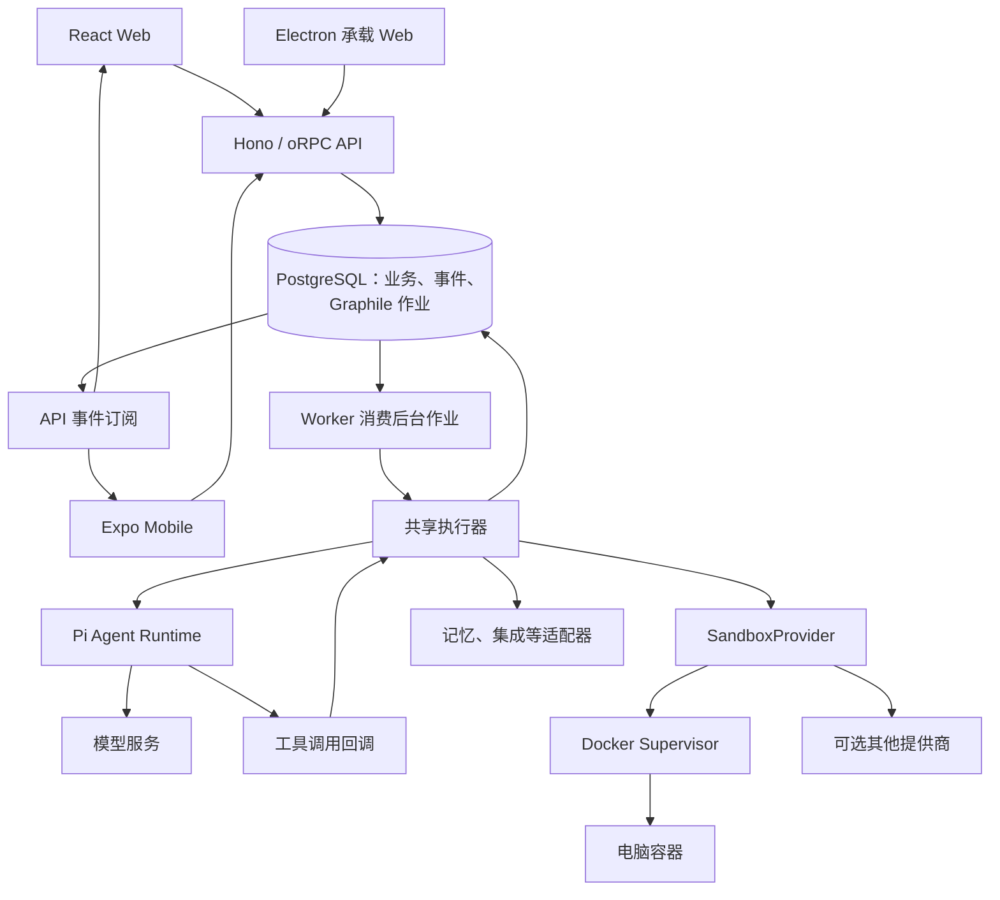
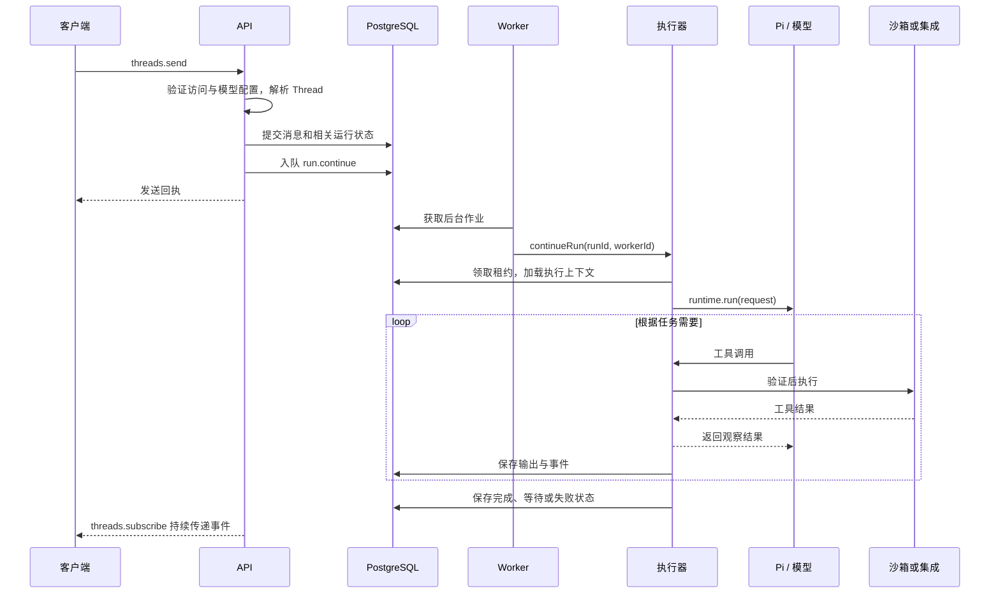

# Rakazo 中文入门指南

本文面向熟悉嵌入式 Linux/C++、开始阅读 TypeScript 全栈项目的开发者，重点串联进程、入口、消息、Agent 和电脑沙箱。内容依据仓库源码整理；生成时没有可用的 Understand Anything 知识图谱，因此阅读顺序来自实际调用关系，而非图谱 tour 或复杂度评分。

更完整的设计背景见[整体架构](architecture.zh-CN.md)，模型循环细节见 [Pi 架构](pi-architecture.zh-CN.md)，电脑环境细节见[电脑运行机制](computer-runtime.zh-CN.md)。

## 1. 先建立进程与数据的概念

Rakazo 为持久化 Bot 提供对话、定时任务、记忆、工具和电脑能力。Bot 是数据库中的产品对象；Run 是一次执行记录；Computer 是工具运行环境。Bot 不等于常驻进程，也不必独占一个容器。

| 熟悉的 Linux/C++ 概念 | 在 Rakazo 中可以如何理解 | 需要区分的地方 |
| --- | --- | --- |
| 多目标工程与公共库 | pnpm workspace 管理 `apps/` 和 `packages/`，Turborepo 编排构建 | 包边界不等于进程边界 |
| 守护进程的 `main()` | API、Worker、Supervisor 各有启动入口 | Web 和移动端是客户端入口 |
| C++ 抽象接口和驱动实现 | `AgentRuntime`、`SandboxProvider` 与具体适配器 | TypeScript 接口在编译后擦除，运行时仍需要校验和能力检查 |
| 持久化工作队列 | Graphile 在 PostgreSQL 中保存作业 | 不依赖进程内消息存活，也不要求单独的队列数据库 |
| 状态机与所有权代次 | Run 状态、租约、`leaseFence` | 分布式租约不等同于单进程 mutex |
| 通知唤醒后读取状态 | PostgreSQL 通知唤醒事件订阅，再读取持久化事件 | 通知本身不是完整可靠的历史记录 |
| 设备控制服务 | Supervisor 提供电脑管理与操作接口 | 它持有 Docker 管理权限，是高权限边界 |

接口定义见 [packages/adapter-kit/src/interfaces.ts](../packages/adapter-kit/src/interfaces.ts) 的 `AgentRuntime`、`SandboxProvider`、`JobPublisher`；状态规则见 [packages/core/src/run-state.ts](../packages/core/src/run-state.ts) 的 `assertTransition()`、`nextFence()`。

TypeScript 中几个经常出现的写法值得先认识：`Promise<T>` 表示异步完成结果；`async`/`await` 通常等待 I/O，不代表创建 OS 线程；`AsyncIterable<T>` 配合 `for await` 消费流；`AbortSignal` 传递取消信号。React 组件负责根据状态渲染界面，不承担后端运行所有权。

## 2. 整体架构与目录

默认后台路径中，Pi 的模型与工具循环运行在 Worker 内，电脑容器负责命令、文件、浏览器和桌面操作。模型服务又是独立边界。API 也装配共享执行器，内存作业路径可在 API 进程内运行，主要用于测试。

| 目录 | 主要职责 |
| --- | --- |
| `apps/web`、`apps/desktop`、`apps/mobile` | Web 界面、Electron 系统集成、移动原生交互 |
| `apps/api`、`apps/worker` | 对外业务服务与后台进程的入口、依赖装配 |
| `apps/www` | Astro 营销站 |
| `packages/contracts` | RPC、事件、产品类型与校验 schema |
| `packages/core` | 共享规则与纯逻辑 |
| `packages/adapter-kit` | 外部能力接口及执行上下文 |
| `packages/adapters` | 执行编排、Pi、沙箱、队列及供应商适配 |
| `packages/db`、`packages/auth`、`packages/memory` | 数据持久化、认证与基础记忆 |
| `packages/chat-ui`、`packages/ui-web`、`packages/ui-tokens` | 聊天组件、Web 组件与共享设计令牌 |
| `packages/testkit`、`packages/logging` | 验证设施与日志 |
| `infra/sandboxes`、`infra/compose` | 电脑镜像、Supervisor 与部署配置 |

`packages/adapters` 同时包含大型业务执行器，不能只按“供应商 SDK 封装目录”理解。前端表达意图，后端负责授权、验证、重试和恢复；新增共享行为应先考虑公共包。

## 3. 启动入口：从哪里开始执行

| 组件 | 文件与关键符号 | 启动时做什么 |
| --- | --- | --- |
| Web | [apps/web/src/main.tsx](../apps/web/src/main.tsx)：`createRoot(...).render()` | 初始化外观、国际化和 Router，挂载 `App` |
| Web 路由 | [apps/web/src/App.tsx](../apps/web/src/App.tsx)：`App()`、`SessionApp()` | 根据会话与路径进入页面，主工作区为 `ShellPage` |
| Electron | [apps/desktop/src/main.ts](../apps/desktop/src/main.ts)：Electron 主进程顶层启动代码 | 管理窗口、服务器目标与系统集成；本地服务栈见 [local-stack.ts](../apps/desktop/src/local-stack.ts) 的 `LocalStackController` |
| Mobile | [apps/mobile/package.json](../apps/mobile/package.json)：`main: expo-router/entry`；[app/_layout.tsx](../apps/mobile/app/_layout.tsx) | Expo Router 启动后加载根布局，具体页面由 `app/` 文件组织 |
| API | [apps/api/src/index.ts](../apps/api/src/index.ts)：`loadRootEnv()`、`loadEnv()`、`createApp()`、`serve()` | 读取环境并启动 HTTP 服务，退出时关闭连接和资源 |
| API 装配 | [apps/api/src/app.ts](../apps/api/src/app.ts)：`createApp()` | 组装依赖，创建 `RPCHandler` 与 Hono 应用 |
| Worker | [apps/worker/src/index.ts](../apps/worker/src/index.ts)：`main()` | 选择 runtime 和 sandbox，创建执行器、后台处理器，启动 job host 与 reconciler |
| Supervisor | [infra/sandboxes/supervisor/src/index.ts](../infra/sandboxes/supervisor/src/index.ts)：Hono 路由与 `serve()` | 暴露电脑管理接口并连接 Docker |
| 电脑容器 | [infra/sandboxes/computer/start.sh](../infra/sandboxes/computer/start.sh)：顶层脚本、`shutdown()` | 作为 PID 1 启动控制服务及图形环境，并处理退出信号 |

根 [package.json](../package.json) 的 `dev` 脚本通过 Turbo 启动 API、Worker、Web 和 Supervisor；它不会替你完成数据库准备与电脑镜像构建。

首次运行可按 [README 源码启动步骤](../README.md) 准备配置、启动 PostgreSQL，再安装依赖、生成 Prisma 客户端、执行迁移、构建沙箱镜像和运行 `pnpm dev`。完整 Linux 容器部署见[本机源码部署](source-deploy.zh-CN.md)。运行环境版本以包清单与对应部署文档为准。

## 4. 消息处理链路：一次发送如何变成执行

先区分几个 ID：Space 表示访问范围，Bot 表示机器人，Thread 表示会话，Message 表示消息，Task/Run 表示任务及执行记录，Computer 表示电脑。实体定义见 [packages/db/prisma/schema.prisma](../packages/db/prisma/schema.prisma)。一条消息不必新建一个 Run，群组分发、运行中补充输入与等待回答有不同处理。

按以下函数追踪即可贯通主路径：

1. **客户端入口**：[apps/web/src/lib/rpc.ts](../apps/web/src/lib/rpc.ts) 使用 `createORPCClient()`、`RPCLink`；移动端 API 封装在 [apps/mobile/lib/api.ts](../apps/mobile/lib/api.ts)。共享 RPC 定义位于 [packages/contracts/src/rpc.ts](../packages/contracts/src/rpc.ts)。
2. **服务端处理**：[apps/api/src/router.ts](../apps/api/src/router.ts) 的 `createRouter()` 内，`threads.send` handler 检查模型配置，调用 `resolveThreadTarget()` 和 `sendThreadMessage()`。
3. **事务与分发**：[apps/api/src/thread-target.ts](../apps/api/src/thread-target.ts) 的 `sendThreadMessage()` 提交消息和相应运行状态，随后由 `enqueueRunsNeedingContinue()` 发布需要继续的 Run。阅读时留意事务提交与入队分开处理的边界。
4. **作业发布和消费**：[packages/adapter-kit/src/background-jobs.ts](../packages/adapter-kit/src/background-jobs.ts) 的 `runContinueJob()` 构造作业；[packages/adapters/src/wakeup.ts](../packages/adapters/src/wakeup.ts) 的 `GraphileJobPublisher.enqueue()` 和 `GraphileJobWorkerHost.start()` 对接 Graphile。
5. **执行分发**：[packages/adapters/src/background-job-handlers.ts](../packages/adapters/src/background-job-handlers.ts) 的 `createBackgroundJobHandlers()` 将 `run.continue` 映射为 `executor.continueRun()`。
6. **结果回传**：[packages/db/src/events.ts](../packages/db/src/events.ts) 的 `appendEvent()`、`followThreadEvents()` 负责事件写入和按游标补读；`createRouter()` 中的 `threads.subscribe` handler 将事件交给客户端。
7. **界面更新**：[apps/web/src/lib/thread-events.ts](../apps/web/src/lib/thread-events.ts) 的 `reduceThreadSnapshot()` 根据事件更新会话快照。

事件通知可以类比“条件变化后唤醒等待者”：`followThreadEvents()` 被通知唤醒后，仍通过 `eventsAfter()` 读取数据库。重连依赖事件序列号和持久化记录，不应只依赖一次实时通知。

## 5. Agent 执行机制：业务调度与模型循环

### 5.1 执行器拥有业务状态

[packages/adapters/src/executor.ts](../packages/adapters/src/executor.ts) 的 `createRunExecutor()` 是核心装配函数，其返回对象的 `continueRun(runId, workerId)` 是后台执行主入口。建议先读这个函数的阶段结构，再按工具需求跳转，避免从文件第一行逐行通读。

`continueRun()` 首先读取 Run，跳过终态，通过带条件的数据库更新领取租约、递增 fence，再进入 `running`。随后获取电脑执行租约，加载 Bot、Thread、Task 等上下文，组织模型配置、指令、记忆和工具，并调用 `deps.runtime.run()` 消费运行时事件。执行器负责把结果映射回消息、事件、等待与终态。

租约类似带到期时间和代次校验的执行所有权。旧 Worker 即使恢复，也不能仅凭旧的所有权继续合法写入。规则见 [packages/core/src/run-state.ts](../packages/core/src/run-state.ts) 的 `assertTransition()`、`nextFence()`；电脑租约见 [computer-lifecycle.ts](../packages/adapters/src/computer-lifecycle.ts) 的 `acquireComputerExecutionLease()`、`renewComputerExecutionLease()`、`releaseComputerExecutionLease()`。

### 5.2 Pi 推进模型与工具循环

[packages/adapters/src/pi-runtime.ts](../packages/adapters/src/pi-runtime.ts) 的 `PiAgentRuntime` 实现 `AgentRuntime`：

- `run()` 返回 `AsyncIterableIterator<AgentRuntimeEvent>`，供执行器逐个消费事件。
- 私有生成器 `runEvents()` 解析模型、建立工具运行上下文，并驱动 Pi 执行。
- `abort()` 中止活动执行；`run()` 返回迭代器的 `return()` 也立即触发取消，避免等待中的模型请求阻塞退出。

工具名称与参数 schema 见 [builtin-tools.ts](../packages/adapters/src/builtin-tools.ts) 的 `builtinAgentTools`；业务工具实现和授权编排可沿 `executor.ts` 中的工具名称追踪。模型生成调用请求，Pi 推进循环，Rakazo 执行器提供受控工具实现，工具适配器接触实际文件或外部服务。

因此，模型输出“文件已写入”不等于文件存在。真正的结果来自工具返回与实际状态检查。可以先跟踪 `read_file` 这一条路径，再看命令、浏览器与外部集成。

### 5.3 等待、取消与恢复

等待用户输入、等待人工接管和失败是不同状态，不应一律视为异常重试。[packages/db/src/events.ts](../packages/db/src/events.ts) 的 `pauseRunForInput()`、`pauseRunForTakeover()`、`finalizeRun()` 处理相关持久化；[apps/api/src/thread-target.ts](../apps/api/src/thread-target.ts) 的 `stopThreadRuns()` 处理停止意图。

[packages/adapters/src/job-reconciler.ts](../packages/adapters/src/job-reconciler.ts) 的 `createJobReconciler()` 根据持久化状态协调恢复。队列恢复不意味着所有外部副作用都可以安全重做：外部操作可能成功但响应丢失，需结合执行器中的副作用记录和审批逻辑判断。

## 6. 沙箱管理：从接口到 Linux 电脑

### 6.1 提供商边界

[packages/adapter-kit/src/interfaces.ts](../packages/adapter-kit/src/interfaces.ts) 的 `SandboxProvider` 类似能力接口，提供 `provision()`、`prepare()`、`execute()`、`readFile()`、`writeFile()`、`observe()`、`act()`、`stop()`、`destroy()` 等操作。`execute()` 返回进程事件流，适合按 stdout、stderr、退出事件理解。

组装过程从 [packages/adapters/src/host-aware-sandbox.ts](../packages/adapters/src/host-aware-sandbox.ts) 的 `createRunSandbox()` 开始，调用 [sandbox-factory.ts](../packages/adapters/src/sandbox-factory.ts) 的 `createSandboxProvider()` 选择实现。`HostAwareSandbox.route()` 根据已有 Computer 的种类选择宿主机或隔离提供商；创建时还会读取部署设置。

各实现能力不同。桌面提供商可能操作宿主机，不能把所有 `SandboxProvider` 都理解为具有容器隔离的实现。

### 6.2 Docker 路径

| 动作 | 适配器函数 | Supervisor 路由 |
| --- | --- | --- |
| 创建或重连电脑 | `DockerSandboxProvider.provision()` | `POST /computers` |
| 执行命令 | `DockerSandboxProvider.execute()` | `POST /computers/:id/exec` |
| 观察与操作桌面 | `observe()`、`act()` | `POST /computers/:id/observe`、`POST /computers/:id/actions` |
| 文件操作 | `listFiles()`、`readFile()`、`writeFile()` | `GET/POST /computers/:id/files` |
| 停止与销毁 | `stop()`、`destroy()` | `POST /computers/:id/stop`、`DELETE /computers/:id` |

适配器在 [packages/adapters/src/docker-sandbox.ts](../packages/adapters/src/docker-sandbox.ts)；服务端路由在 [infra/sandboxes/supervisor/src/index.ts](../infra/sandboxes/supervisor/src/index.ts)。Supervisor 的 `managedContainer()` 核对受管容器，`runContainerCommand()` 执行容器命令；创建参数由 [computer-spec.ts](../infra/sandboxes/supervisor/src/computer-spec.ts) 的 `containerCreateOptions()` 等函数组织。

电脑业务生命周期还经过 [packages/adapters/src/computer-lifecycle.ts](../packages/adapters/src/computer-lifecycle.ts) 的 `provisionComputer()`：数据库 Computer 记录、提供商资源与执行租约需要协调，不能只看 Docker 容器是否存在。

### 6.3 容器内部与持久化

[infra/sandboxes/computer/Dockerfile](../infra/sandboxes/computer/Dockerfile) 定义电脑镜像；[start.sh](../infra/sandboxes/computer/start.sh) 启动 Xvfb、桌面及控制服务。作为 PID 1，脚本通过 `shutdown()` 处理信号和子进程退出，这部分可直接用熟悉的 Linux 进程模型阅读。

[control.py](../infra/sandboxes/computer/control.py) 的 `Handler` 处理容器内控制请求，`run_control_argv()` 执行受约束的控制命令，`capture()` 采集屏幕。

同一 Space 的 Team Computer 可由多个 Bot 共享；独立工作目录、浏览器资料和显示会话用于组织工作，不构成相互不信任进程之间的隔离。Private Computer 提供独立电脑环境。数据库保存产品状态，工作区保存文件，容器根文件系统和镜像又有不同生命周期；重建容器不能简单等同于删除机器人，也不能保证保留容器内的所有临时安装。

## 7. 推荐源码阅读顺序

按“先边界、再一次消息、最后异常路径”阅读，每一步带着一个问题：

| 顺序 | 文件与符号 | 读完应能回答 |
| --- | --- | --- |
| 1 | [package.json](../package.json)、[pnpm-workspace.yaml](../pnpm-workspace.yaml)、[AGENTS.md](../AGENTS.md) | 有哪些应用与公共包？项目约束是什么？ |
| 2 | [schema.prisma](../packages/db/prisma/schema.prisma)、[contracts/src/domain.ts](../packages/contracts/src/domain.ts)、[contracts/src/rpc.ts](../packages/contracts/src/rpc.ts) | Bot、Thread、Run、Computer 如何关联？客户端能发什么请求？ |
| 3 | [interfaces.ts](../packages/adapter-kit/src/interfaces.ts)：`AgentRuntime`、`SandboxProvider` | 模型循环、工具执行和平台业务的边界在哪里？ |
| 4 | [API index.ts](../apps/api/src/index.ts)、[app.ts](../apps/api/src/app.ts)：`createApp()`；[Worker index.ts](../apps/worker/src/index.ts)：`main()` | 谁组装依赖？哪些组件在同一进程？ |
| 5 | [router.ts](../apps/api/src/router.ts)：`threads.send`；[thread-target.ts](../apps/api/src/thread-target.ts)：`sendThreadMessage()` | 一次发送如何提交数据库并入队？ |
| 6 | [wakeup.ts](../packages/adapters/src/wakeup.ts)、[background-job-handlers.ts](../packages/adapters/src/background-job-handlers.ts)：`createBackgroundJobHandlers()` | 后台作业如何变成 `continueRun()`？ |
| 7 | [executor.ts](../packages/adapters/src/executor.ts)：`createRunExecutor()`、`continueRun()` | 执行权、上下文、工具和结果如何组织？ |
| 8 | [pi-runtime.ts](../packages/adapters/src/pi-runtime.ts)：`PiAgentRuntime.run()`、`runEvents()` | 模型事件流与工具结果如何往返？ |
| 9 | [computer-lifecycle.ts](../packages/adapters/src/computer-lifecycle.ts)、[docker-sandbox.ts](../packages/adapters/src/docker-sandbox.ts)、[Supervisor](../infra/sandboxes/supervisor/src/index.ts) | 工具操作怎样到达真实 Linux 环境？ |
| 10 | [events.ts](../packages/db/src/events.ts)：`followThreadEvents()`；[thread-events.ts](../apps/web/src/lib/thread-events.ts)：`reduceThreadSnapshot()` | 数据怎样可靠地回到界面？ |
| 11 | [job-reconciler.ts](../packages/adapters/src/job-reconciler.ts)、[run-state.ts](../packages/core/src/run-state.ts) | Worker 退出、租约过期、取消和接管后如何恢复？ |
| 12 | [Web main.tsx](../apps/web/src/main.tsx)、[App.tsx](../apps/web/src/App.tsx)、[Mobile _layout.tsx](../apps/mobile/app/_layout.tsx) | 各客户端如何表达同一套产品意图？ |

阅读时可用 `rg -n 'sendThreadMessage|continueRun|runEvents' apps packages` 查找定义和调用点；在大文件中先按符号跳转，再阅读该阶段的辅助函数。

## 8. 复杂区域与首次验证

以下是按职责集中程度判断的阅读难点，没有图谱复杂度评分：

- `executor.ts`：混合运行状态、上下文、工具授权、副作用与恢复。先跟踪一个工具及一次正常运行，再看审批和重试。
- `router.ts`、`thread-target.ts`：权限、群组、追加输入与事务边界较多。不要从普通单 Bot 发送推导所有消息分支。
- Supervisor `index.ts`：涉及 Docker 权限、网络、文件、屏幕和并发锁。修改前同时核对客户端适配器与身份检查。
- `pi-runtime.ts`：涉及异步事件、取消、模型能力及工具循环；离线模拟协议与真实模型行为需要分别验证。

初次学习可以选择一个只读任务，记录其 Thread/Run 在源码中的流转位置，并跟踪一次 `read_file` 的参数、工具结果和界面事件。使用虚构内容，避免把凭据、日志中的个人数据或真实工作文件加入仓库。

验证方法见 [agent-verification.md](agent-verification.md)。修改纯规则时优先跑对应单测；修改模型协议或工具往返时看 Pi 离线测试；涉及持久化、事务和租约时使用相应数据库集成测试；涉及实际桌面操作时再进入电脑验证流程。桌面 Electron E2E 会打开真实窗口，不作为维护者机器上的常规验证，交给 CI 的虚拟显示环境执行。

模型、记忆、语音和外部集成应保持可选并置于统一接口之后。新需求先判断它属于共享业务、外部适配还是原生平台交互，再选择修改位置。
