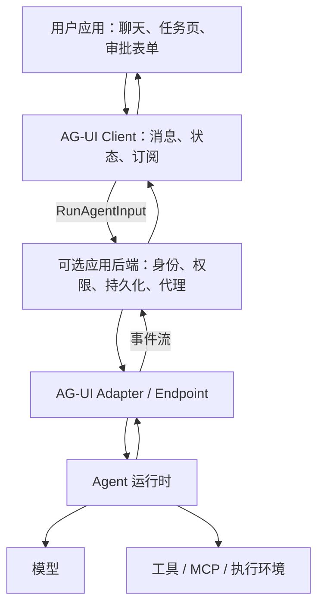
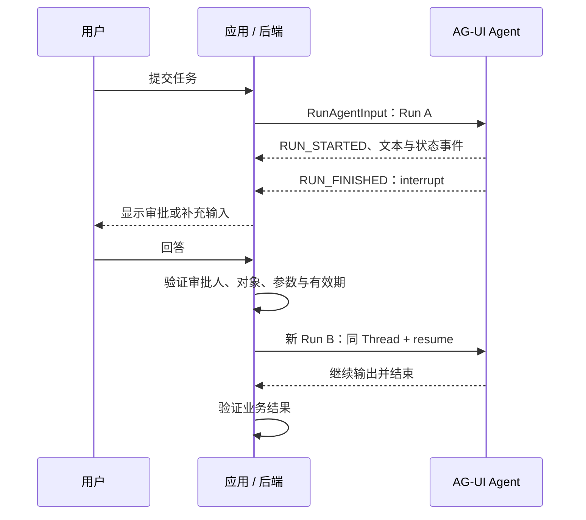

# AG-UI 分析报告：产品定位、协议架构与企业落地

分析日期：2026-10-19。对象：[ag-ui-protocol/ag-ui](https://github.com/ag-ui-protocol/ag-ui)。

本报告依据官方仓库、TypeScript 客户端源码和官方文档整理。协议语义优先采用当前公开的 **1.0 规范**；仓库 `main`、已发布 SDK、框架集成和文档可能处于不同版本，本文不代表对某个发布包的完整兼容性认证。企业应用建议是分析判断，不是协议已实现的产品功能。

## 1. 结论与产品定位

**AG-UI 是 Agent 与面向用户的应用之间的交互协议及 SDK 生态。** 它统一运行输入、流式消息、工具调用、共享状态和人工交互的表达，降低应用与不同 Agent 框架之间的适配成本。其主要用户是应用开发者与 Agent 框架开发者，而非直接使用机器人完成工作的业务员工。[官方定位](https://docs.ag-ui.com/introduction)

可以用 Linux/C++ 背景来理解：AG-UI 更接近跨实现的消息协议与客户端库；Agent 框架类似执行引擎；OpenBot、Rakazo 才是组织用户、任务和执行环境的应用。协议不会自己提供模型推理、Linux 隔离或企业审批系统。

| 对象 | 定位 | 与 AG-UI 的关系 |
| --- | --- | --- |
| Agent 运行时 | 推理、上下文与工具循环 | 将自身事件转换为 AG-UI，或由适配层转换 |
| AG-UI | 应用与 Agent 的交互契约 | 标准化输入、事件和交互语义 |
| CopilotKit | Agent 应用开发框架与相关产品生态 | 可消费 AG-UI；不是协议本身 |
| OpenBot / Rakazo | 面向用户的工作平台 | 可在 Agent 接入边界采用 AG-UI |
| 企业业务系统 | 工作对象、权限、规则与验收 | 仍需业务 API、工具和流程集成 |

协议价值来自减少重复集成：不同后端可以复用消息、工具和状态的呈现逻辑。但相同事件格式不保证相同能力、权限语义和恢复质量；采用方仍需约定兼容范围。

## 2. 在协议体系中的位置

| 协议或机制 | 主要解决的问题 | 不能据此直接推导的能力 |
| --- | --- | --- |
| AG-UI | Agent 与应用如何交换输入、输出和交互状态 | 完整的跨企业任务协作与授权 |
| MCP | Agent 如何使用工具与数据能力 | 业务流程自动拥有审批、可靠交付和验收 |
| A2A | Agent 之间如何交互、协调工作 | 应用界面的完整交互体验 |
| A2UI 等生成式 UI 规范 | 如何描述要渲染的界面 | Agent 会话、执行资源与业务持久化 |
| HTTP/SSE、WebSocket | 如何传输数据 | 上层事件的业务含义与执行权限 |

前三者是互补关系，不宜选一个替代全部层次；AG-UI 也不是生成式 UI 描述语言，可以承载或配合这类界面方案。[协议分工](https://docs.ag-ui.com/introduction#agentic-protocols)、[生成式 UI 边界](https://docs.ag-ui.com/concepts/generative-ui-specs)

## 3. 架构分析

### 3.1 逻辑分层



AG-UI 不要求上述每层都成为独立进程。适配器可以位于 Agent 服务内部；应用后端也可以成为 AG-UI 消费方。企业场景通常适合通过应用后端接入，避免将长期服务凭据和授权判断放在浏览器。后端代理本身仍需实现实际授权。[官方架构](https://docs.ag-ui.com/concepts/architecture)

### 3.2 核心数据与运行单位

1.0 的应用到 Agent 输入为 `RunAgentInput`。关键字段如下：

| 字段 | 含义 | 工程注意点 |
| --- | --- | --- |
| `threadId` | 会话标识 | 不等于账号或权限证明 |
| `runId` | 本次交互运行标识 | 不应直接等同于企业业务任务 ID |
| `messages` | 本次向 Agent 展示的有序历史 | 不保证包含企业平台保存的全部历史 |
| `tools` | 应用提供的工具定义 | 工具声明不等于执行授权 |
| `context` | 应向模型提供的上下文 | 不适合放仅供传输层使用的秘密 |
| `state` | 本次交互的共享初始状态 | 不等于数据库中的权威业务状态 |
| `forwardedProps` | 应用自定义透传参数 | 协议不定义其业务含义 |
| `resume` | 对先前中断的回答 | 与普通工具结果返回路径不同 |
| `protocolVersion` | 发送方协议版本声明 | 与 npm 包版本不是同一个概念 |

`threadId`、`runId`、`messages` 是必要输入；其余字段按规范具有各自的可选语义。平台应保存业务任务、协议 Run 和底层 Agent 会话之间的映射。[Run Input 规范](https://docs.ag-ui.com/spec/1.0/basic/run-input)

### 3.3 传输：双向交互不等于全双工连接

默认 HTTP 绑定是应用发送 JSON `POST`，Agent 返回 SSE，每个 `data` 承载一个完整协议事件。它适合通过常见 Web 基础设施传递增量输出；协议层还可采用其他传输或绑定。[HTTP/SSE 规范](https://docs.ag-ui.com/spec/1.0/basic/transports/http-sse)

必须注意两个限制：

- 默认绑定没有运行中的消费者回传通道。工具结果、人工回答通常通过下一次 Run 输入返回。
- 默认 SSE 绑定不使用 `Last-Event-ID` 恢复流。连接中断后，不能依靠同一绑定无损续接原流；重新发起执行必须考虑重复副作用。

HTTP `200` 只表示流已建立，不表示任务成功。未收到终止事件就断线，应记录为截断或结果待确认，不能擅自合成成功或取消。[传输错误与恢复边界](https://docs.ag-ui.com/spec/1.0/basic/transports/http-sse)

## 4. 事件模型与交互流程

### 4.1 常用事件

| 类别 | 代表事件 | 应用用途 |
| --- | --- | --- |
| Run / Step | `RUN_STARTED`、`RUN_FINISHED`、`RUN_ERROR`、`STEP_STARTED`、`STEP_FINISHED` | 生命周期与阶段进度 |
| 文本 | `TEXT_MESSAGE_START`、`TEXT_MESSAGE_CONTENT`、`TEXT_MESSAGE_END` | 逐段呈现回答 |
| 工具 | `TOOL_CALL_START`、`TOOL_CALL_ARGS`、`TOOL_CALL_END`、`TOOL_CALL_RESULT` | 显示调用、参数和结果 |
| 状态 | `STATE_SNAPSHOT`、`STATE_DELTA`、`MESSAGES_SNAPSHOT` | 状态及消息重建 |
| 扩展 | `CUSTOM`、`RAW` | 业务扩展及原始数据桥接 |

这是阅读索引，不是某版本完整事件枚举；不应继续把早期概览中的“约 16 类事件”当作当前固定总数。现行规范和 SDK 还涉及 reasoning、activity、subagent 等表达。[事件概念](https://docs.ag-ui.com/concepts/events)、[1.0 迁移说明](https://docs.ag-ui.com/migrating-to-1-0)

### 4.2 生命周期与业务状态

`RUN_STARTED` 开启 Run；`RUN_FINISHED` 表示非失败结束，但应读取 `outcome` 区分成功、中断与取消；`RUN_ERROR` 报告失败。Run 结束前需要满足事件闭合规则，不能只按网络连接是否结束判断完成。[生命周期规范](https://docs.ag-ui.com/spec/1.0/events/lifecycle)

应用层还必须区分三种“完成”：

1. 协议 Run 正常结束。
2. Agent 完成其子任务。
3. 企业业务通过验收。

例如工具调用交给应用处理时，当前 Run 可以成功结束，但尚未执行刷写设备、运行测试或获得人工批准。协议终态不能直接作为业务验收结果。

### 4.3 工具调用的正确解释

工具参数可以分片到达，应用必须等 `TOOL_CALL_END` 后再处理；结束只表示参数完整，不代表 JSON 合法、动作已执行或授权通过。

Agent 自己执行的工具可以在同一 Run 返回结果；应用提供的 frontend tool 由应用执行，结果作为下一次输入的 tool message 回传。1.0 中，这种待应用执行的工具调用属于成功结束路径，可通过 `pendingToolCallIds` 表达，不应错误映射为 interrupt。这里的“frontend”表达应用侧边界，不强制特权动作必须在浏览器内执行。[工具规范](https://docs.ag-ui.com/spec/1.0/events/tool-calls)

### 4.4 人工中断与恢复

真正的 interrupt 用 `RUN_FINISHED` 的 interrupt outcome 表达。应用收集回答后，在同一 Thread 的新 Run 中通过 `resume` 回传，匹配原中断 ID；恢复输入需覆盖待处理中断，明确回答或放弃。它与工具结果通过消息回传的路径不同。[中断规范](https://docs.ag-ui.com/spec/1.0/basic/patterns/interrupt-resume)



协议回答只传递决定；审批人资格、动作绑定、有效期、审计和防重放仍需应用实现。更不能把共享状态中的 `approved: true` 直接当作可信授权。

### 4.5 共享状态

`STATE_SNAPSHOT` 替换共享状态；`STATE_DELTA` 使用 JSON Patch（RFC 6902）更新；补丁必须基于正确基线按序应用。它适合进度、候选方案和任务表单，不自动解决数据库事务、多用户冲突和跨进程持久化。[状态文档](https://docs.ag-ui.com/concepts/state)

建议将共享状态视为面向交互的投影：Agent 可以提出修改，后端验证后更新权威记录。企业权限、设备占用和任务验收结果不应仅靠前端补丁决定。

## 5. 仓库结构与源码阅读入口

以下路径属于 AG-UI 上游仓库，不是 Rakazo 本地文件。链接指向 `main`，可能随上游演进变化。

| 路径 | 阅读目标 |
| --- | --- |
| [spec/](https://github.com/ag-ui-protocol/ag-ui/tree/main/spec) | 协议定义与 schema；优先对照 1.0 行为规范 |
| [sdks/typescript/packages/core/](https://github.com/ag-ui-protocol/ag-ui/tree/main/sdks/typescript/packages/core) | 输入、消息、事件的类型与校验入口 |
| [client/src/agent/agent.ts](https://github.com/ag-ui-protocol/ag-ui/blob/main/sdks/typescript/packages/client/src/agent/agent.ts) | `AbstractAgent`、`runAgent()`：客户端生命周期、消息状态、订阅、中间件 |
| [client/src/agent/http.ts](https://github.com/ag-ui-protocol/ag-ui/blob/main/sdks/typescript/packages/client/src/agent/http.ts) | `HttpAgent.requestInit()`、`run()`、`abortRun()`：请求构造、流转换和本地取消 |
| [integrations/](https://github.com/ag-ui-protocol/ag-ui/tree/main/integrations) | 各 Agent 框架的适配方式 |
| [middlewares/](https://github.com/ag-ui-protocol/ag-ui/tree/main/middlewares) | 中间件相关实现 |
| [apps/](https://github.com/ag-ui-protocol/ag-ui/tree/main/apps) | 示例与交互展示 |
| [docs/](https://github.com/ag-ui-protocol/ag-ui/tree/main/docs) | 文档与概念解释 |

`HttpAgent.run()` 构建请求并转换响应事件流；`abortRun()` 使用 AbortController 中止请求。关闭客户端请求不证明所有后端命令及远程作业都已停止，执行系统还要提供可确认的取消机制。[HttpAgent 源码](https://github.com/ag-ui-protocol/ag-ui/blob/main/sdks/typescript/packages/client/src/agent/http.ts)

`AbstractAgent` 管理客户端消息、状态、订阅和事件处理链。它是一层交互执行抽象，不能视为企业任务数据库或分布式调度器。[AbstractAgent 源码](https://github.com/ag-ui-protocol/ag-ui/blob/main/sdks/typescript/packages/client/src/agent/agent.ts)

建议阅读顺序：协议定位 → Run Input → 生命周期 → HTTP/SSE → 工具 → interrupt/resume → 状态 → `HttpAgent` → `AbstractAgent` → 一个框架集成。1.0 以 schema 为类型来源并提供行为规范；锁定 SDK 版本后还应核对迁移说明，不要混用旧概念示例和新规范。[迁移指南](https://docs.ag-ui.com/migrating-to-1-0)

## 6. 企业落地价值与边界

### 6.1 能带来的价值

- **降低交互适配成本**：替换后端时，消息、工具与状态呈现可尽量保持一致。
- **让业务界面参与任务**：用户可以通过表单、审批卡片和状态视图参与，而非全部依赖聊天文本。
- **统一观察入口**：不同运行时的进度与工具活动可以映射到同一界面，但质量取决于适配完整度。
- **把运行时与应用拆开**：企业平台保留业务对象、规则和验收，Agent 引擎可独立演进。

以上是基于协议边界的架构判断，并非采用 AG-UI 后自动产生的效果。对于只做一次性请求、没有交互和多后端需求的系统，自有简单 API 可能更合适。

### 6.2 仍由企业平台承担的职责

| 领域 | 平台需要实现 |
| --- | --- |
| 身份与授权 | 用户、工作区、Agent、工具、执行节点之间的权限映射 |
| 可靠运行 | 队列、租约、重试、取消确认、故障对账 |
| 数据 | 权威状态、历史事件、附件访问、保留与删除策略 |
| 审批 | 审批人资格、明确参数、有效期、不可复用的执行授权 |
| 执行环境 | WSL、容器、构建机、设备及本地工具访问 |
| 验收 | 检查文件、测试、版本和业务结果，保存证据 |
| 可观测性 | 关联业务任务、协议 Run、外部会话、工具和费用 |

尤其要避免“接入 AG-UI 就能统一治理外部 Agent”的误解。若 Agent 直接使用自身 Shell 或第三方凭据，动作可以绕过平台工具网关。治理必须落实在实际执行通道和凭据边界上。

## 7. 对 Rakazo、OpenBot 与外部 Agent 的意义

### 7.1 对 Rakazo：适合做边界适配，暂不建议全面替换内部协议

当前本地包清单未发现 `@ag-ui` 依赖。Rakazo 已有自己的 RPC、产品事件和 Agent 接口：

| Rakazo 入口 | 可采用的方式 | 注意点 |
| --- | --- | --- |
| [AgentRuntime](../packages/adapter-kit/src/interfaces.ts) 的 `run()`、`abort()` | 新增 AG-UI 运行时适配器 | 必须映射工具交接、中断与取消语义 |
| [AgentRuntimeEvent](../packages/adapter-kit/src/types.ts) | 将外部事件转为内部运行时事件 | 不要透传原始事件后假定内部都能处理 |
| [createRunExecutor()](../packages/adapters/src/executor.ts) | 保留业务编排与执行所有权 | 协议 Run 与业务 Run 可能一对多 |
| [createRouter()](../apps/api/src/router.ts) | 继续提供现有产品 RPC | 不必为接入 Agent 重写所有业务接口 |
| [followThreadEvents()](../packages/db/src/events.ts) | 保留持久化事件与游标补读 | 默认 AG-UI SSE 不能替代这层恢复机制 |
| [SandboxProvider](../packages/adapter-kit/src/interfaces.ts) | 继续控制实际执行环境 | 不会因为外部 Agent 接入自动受管 |

推荐接入位置为：外部 Agent → AG-UI 适配器 → Rakazo 执行器与持久化事件 → 现有 Web/Electron/Mobile。先把协议约束封装在适配边界，避免把版本差异传播到全部客户端。

### 7.2 对 OpenBot：AG-UI 是接入层，治理来自产品实现

OpenBot 使用外部 AG-UI Agent 端点，并在产品侧组织权限和受管工具网关。它的团队共享、审批和审计属于应用层设计，不是 AG-UI 自带功能。选用相同协议并不意味着可以直接复制其企业能力。[OpenBot 架构](https://github.com/CopilotKit/OpenBot/blob/main/docs/architecture.md)

### 7.3 对 Codex / Claude 等 Agent：仍需适配器

对这类运行时，应分别验证其 SDK 或服务输出如何转换成 AG-UI；协议兼容并不等于继承原厂应用的所有功能。本文未对具体 Codex/Claude 集成做兼容性认证。

重点核对：工具是否由运行时直接执行、能否暂停等待应用审批、能否可靠取消、外部会话如何恢复、调用费用如何归属。若这些语义无法等价映射，应声明能力限制或采用有边界的子任务委派。

### 7.4 对成员本地 WSL Shell：不解决节点连接本身

```text
共享业务后端
  ├─ 身份、任务、审批、验收
  ├─ AG-UI 适配器 ↔ Agent 服务
  └─ 执行节点通道 ↔ 成员 WSL / 构建机 / 实验室
```

AG-UI 可以承担 Agent 交互，但本地节点的注册、主动连接、权限、目录边界、资源占用和离线处理仍需单独实现。浏览器 frontend tool 也不意味着浏览器因此拥有本机 Shell 权限。

## 8. 推荐验证路线

以下是建议，不是已实施改造。

1. **固定兼容范围**：锁定 SDK 和规范版本，声明文本、工具、状态、中断等能力，先不用自定义事件承载核心授权。
2. **只读链路**：以日志分析为例，验证事件顺序、错误、截断、消息和状态映射。
3. **受控工具**：加入一个只读业务工具，确认调用结束后才执行，结果正确返回下一 Run。
4. **人工交互**：分别验证 frontend tool 与 interrupt/resume，检查审批参数和身份绑定。
5. **故障验证**：断网、重复提交、取消、Worker 重启、补丁基线不一致；确认不会误报成功或重复执行副作用。
6. **实际业务试点**：接入指定执行环境，产出可验收报告，再评估适配成本与底层 Agent 替换成本。

适配器应保留供应商无关契约，并使用离线录制或合成事件流验证；协议测试通过后，再进行真实 Agent 与业务环境验证。验收指标包括工具结果匹配、无授权执行次数、异常恢复结果和业务合格交付率，而不是只看消息能否显示。

## 9. 选型判断

AG-UI 适合需要多运行时接入、流式交互、应用工具和人工参与的产品；它不应承担企业的全部业务协议，也不能单独构成完整的可靠执行系统。

对 Rakazo，更合理的路线是把 AG-UI 作为可选的 Agent 接入协议，保留已有的业务状态与事件恢复机制，逐步补齐权限和执行节点。项目的长期价值仍应体现在企业流程、执行环境和验收闭环上。

所有上游链接均为官方仓库或官方文档。后续实施时，应记录采用的发布版本和提交，而非仅依赖本文所列的移动 `main` 链接。
