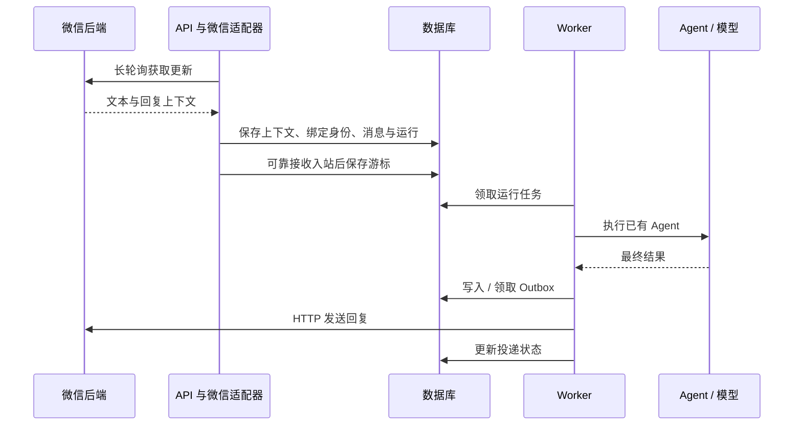

# Rakazo 初学者微信接入教程与操作手册

本文带你通过“个人微信与 Rakazo Agent 对话”学习项目结构，逐步完成协议验证、适配器开发、账号绑定、可靠投递和设置入口。

**文档状态：开发教程，功能尚待实现。** 当前仓库没有微信适配器、微信扫码 RPC 或微信连接页面。下文明确区分已有代码、建议新增文件与学习示例；文件名和 RPC 名称中的“建议”不代表现有接口。核对日期：2026-10-16。

## 1. 先确定要做的功能

首版目标：用户扫码连接微信，在微信 ClawBot 会话发送文本，由已有 Rakazo Agent 执行并回复最终结果。

首版限定一个微信连接、私聊、文本、一个入站监听实例。模型、沙盒、工具授权仍使用 Rakazo 原有配置。先验证插件入口在测试账号上可用，再投入完整开发。

这不等同于接管个人微信所有好友、普通微信群、朋友圈或历史消息。不要把企业微信机器人、公众号、微信客服与本文的 iLink 路线混为一谈。普通群聊、多媒体、多账号、多实例接管需要独立验证与后续设计。

### 参考项目如何选择

- [OpenClaw 主仓库](https://github.com/openclaw/openclaw)：了解渠道插件与 Agent 的边界。
- [腾讯微信插件](https://github.com/Tencent/openclaw-weixin)：微信协议实现的主要参考，采用 TypeScript。
- [插件协议说明](https://github.com/Tencent/openclaw-weixin/blob/main/docs/protocol_zh_CN.md)：查字段与传输行为。
- [插件许可证](https://github.com/Tencent/openclaw-weixin/blob/main/LICENSE)：移植代码前核对，保留要求的版权与许可声明。

微信插件通过 OpenClaw 插件 SDK 接入，不能直接安装到 Rakazo。参考或移植协议部分，把 OpenClaw 的运行时调用替换为 Rakazo 的共享消息接口。协议说明也明确提醒：客户端源码体现的行为不是完整服务端契约，最终以真实账号验证为准。

## 2. 学习路线与工作量

| 阶段 | 产物 | 退出条件 |
| --- | --- | --- |
| A：理解已有链路 | 一张调用图和基线测试记录 | 能解释 API、Worker、适配器与数据库分工 |
| B：独立协议实验 | 本地文本回声程序 | 扫码后收到测试文本并回复 |
| C：接入已有消息体系 | 微信适配器与组装代码 | 微信输入触发自己的 Agent，结果回到微信 |
| D：恢复与安全 | 状态存储、去重、离线测试 | 重启、重放、失败投递可验证 |
| E：产品入口 | 扫码、状态、断开、重连 | 适用客户端均有可用路径 |

熟悉项目的工程师预计技术打通 2–3 人日，MVP 累计 4–6 人日，可交付首版累计 7–10 人日。这是估算，不是已验证工期。初学者可预留 2–4 周全职学习；业余投入按阶段完成，不用按日期赶进度。

每阶段保留四项私人笔记：读了哪些符号、做了什么实验、预期是什么、实际结果是什么。公开笔记只用虚构标识和数据。

## 3. 准备开发环境

所有命令默认从仓库根目录运行。先阅读 [AGENTS.md](../AGENTS.md)、[架构说明](architecture.zh-CN.md)、[贡献指南](../CONTRIBUTING.md)。

```bash
git status --short
git rev-parse HEAD
node --version
pnpm --version
docker version
```

当前根目录 `package.json` 要求 Node.js `^22.22.2 || ^24.0.0 || >=26.0.0`，包管理器为 pnpm 9.15.0。版本变化以仓库为准。若工作区已有改动，先识别归属，保留其他人的工作。

工作区干净时可创建学习分支：

```bash
git switch -c feat/weixin-channel
```

### 首次运行项目

按 [README 的源码开发步骤](../README.md#local-development-source-checkout)准备 `.env`、数据库、依赖和开发服务。不要覆盖已存在的 `.env`。数据库密码与连接串应匹配，应用各密钥应独立生成；不要将其写入本教程或提交到 Git。

完成配置后，README 中的核心启动命令为：

```bash
docker compose --env-file .env \
  -f infra/compose/docker-compose.yml \
  -f infra/compose/docker-compose.postgres-host.yml \
  up postgres -d
pnpm install
pnpm db:generate
pnpm db:migrate
pnpm sandbox:build
pnpm dev
```

宿主机开发通过 overlay 暴露数据库端口，`.env` 的 `DATABASE_URL` 必须与其一致。不要同时启动占用相同端口的源码服务和已部署服务。完整容器部署另见[源码部署指南](source-deploy.zh-CN.md)。

打开 `http://127.0.0.1:5173`，创建测试账号、连接模型并创建 Agent。先在 Web 发一条简单文本，确认 Agent 能正常回复。微信功能只增加消息入口，不解决原本的模型或 Worker 配置问题。

只阅读代码和运行部分离线单测时，不必先启动完整产品；需要数据库的测试另有运行条件。不要运行 `compose:down` 来“重置环境”：当前脚本含 `-v`，会删除数据卷。

## 4. 阶段 A：沿 Telegram 理解 Rakazo

### 六个初学者术语

| 术语 | 在本任务中的含义 |
| --- | --- |
| 契约（contract） | 上下游共同遵守的字段和接口 |
| 适配器（adapter） | 把微信格式与 Rakazo 格式互相转换 |
| 组装入口（composition root） | API / Worker 选择并创建适配器的位置 |
| 游标（cursor） | 下次从哪里继续拉取微信消息的位置 |
| Outbox | 数据库中的待发送结果及其投递状态 |
| 幂等 / 去重 | 同一事件重试时不重复创建逻辑操作；不自动等于外部服务只收到一次 |



图中微信存储步骤是拟实现方案。实际事务和作业提交边界需要核对已有实现；不能只因调用了内存回调就假设消息已经可靠入库。

### 阅读顺序

| 次序 | 现有文件 | 重点问题 |
| --- | --- | --- |
| 1 | [interfaces.ts](../packages/adapter-kit/src/interfaces.ts) 的 `MessagingSurface` | 外部渠道必须提供哪些操作？ |
| 2 | [types.ts](../packages/adapter-kit/src/types.ts) 的 `MessagingInboundMessage` | 一条统一消息需要哪些信息？ |
| 3 | [messaging-platforms.ts](../packages/adapters/src/messaging-platforms.ts) | Telegram 如何注册，为什么 Worker 不轮询？ |
| 4 | [chat-sdk-surface.ts](../packages/adapters/src/chat-sdk-surface.ts) | Chat SDK 的消息如何映射给 Rakazo？ |
| 5 | [app.ts](../apps/api/src/app.ts) | 谁注册 `onInbound`，谁启动和停止监听？ |
| 6 | [messaging-inbound.ts](../apps/api/src/messaging-inbound.ts) | 如何兑换绑定码、去重并创建运行？ |
| 7 | [messaging.ts](../packages/db/src/messaging.ts) | 外部身份如何关联 Rakazo 用户和 Agent？ |
| 8 | [messaging-delivery.ts](../packages/adapters/src/messaging-delivery.ts) | 如何保存回复并处理投递失败？ |
| 9 | [Worker 入口](../apps/worker/src/index.ts) | Worker 如何创建只负责发送的消息服务？ |

用符号定位，避免依赖会变化的行号：

```bash
rg -n 'MessagingSurface|MessagingInboundMessage' packages/adapter-kit/src
rg -n 'pollInboundMessages|telegram|lark|whatsapp' packages/adapters/src/messaging-platforms.ts
rg -n 'messaging.onInbound|messaging.initialize|messaging.shutdown' apps/api/src/app.ts
rg -n 'clientNonce|redeem|link' apps/api/src/messaging-inbound.ts packages/db/src/messaging.ts
rg -n 'messagingOutbound|sendToThread' packages/adapters/src/messaging-delivery.ts
```

### 哪些已有方案直接沿用

- Telegram：API 启动监听，Worker 只发消息；初始化和退出必须管理监听生命周期。
- WhatsApp / 飞书：Worker 独立 HTTP 发送，平台凭证与翻译封装在适配器。
- 公共消息链路：身份绑定、运行触发、授权边界、去重、Outbox 和恢复。

当前飞书配置采用 Webhook，不能把它当作已验证的长连接实现。微信的 HTTP 发送也不要求 Worker 持有 API 的入站连接。

### 记录测试基线

```bash
pnpm exec vitest run packages/adapters/src/telegram-messaging.test.ts packages/adapters/src/messaging-platforms.test.ts packages/adapters/src/chat-sdk-surface.test.ts
pnpm exec vitest run apps/api/src/messaging-inbound.test.ts packages/adapters/src/messaging-delivery.test.ts
```

这些用例用于理解已有行为。记录失败是否在修改前已存在；不要顺手改无关问题。阅读测试时重点找模拟 HTTP、身份绑定和失败重试的断言。

**阶段验收：**用自己的话解释：为什么 API 和 Worker 不能都轮询？同一条微信消息拉到两次会怎样？为什么结果应先进入 Outbox？

## 5. 阶段 B：独立验证微信协议

先写一个只回声、不执行工具的本地实验，避免一次同时排查微信、数据库和 Agent。

### 5.1 固定参考版本

在仓库外的独立参考目录克隆腾讯插件，记录 commit。不要向 Rakazo 添加整个上游仓库或安装 OpenClaw 作为产品运行依赖。

```bash
git clone https://github.com/Tencent/openclaw-weixin.git /tmp/rakazo-weixin-reference
git -C /tmp/rakazo-weixin-reference rev-parse HEAD
```

目录已存在时先检查，勿覆盖。依次读 `src/api/types.ts`、`src/api/api.ts`、`src/auth/login-qr.ts`、`src/monitor/monitor.ts`，再看 `src/channel.ts` 中与 OpenClaw SDK 的交界。

在学习记录中标注上游 commit；后续若源码发生变化，可以判断差异，而不是盲目跟随 `main`。

### 5.2 建立实验程序

**建议新增，当前不存在：**`packages/adapters/src/dev/weixin-echo.ts`。该脚本不从正式 `index.ts` 导出，不随 API 自动启动。先完成以下顺序：

1. 实现请求包装：固定官方登录入口，区分 HTTP 错误与协议业务错误，用运行时校验解析响应。
2. 按上游当前实现获取二维码，在本机展示；不要记录完整登录响应。
3. 实现二维码状态轮询：等待、扫码、成功、过期、验证码、取消等状态分别处理。
4. 登录成功后，凭证只留内存，开始 `getUpdates` 长轮询。
5. 从收到的消息中选择有效入站文本，记录消息 ID；忽略自身发送、系统事件和不支持类型。
6. 使用该入站消息的回复上下文发送一次 `echo: <文本>`，使用稳定发送 ID。
7. 使用 `AbortController` 处理退出，停止拉取，不让旧进程继续运行。

完成脚本后才执行：

```bash
pnpm exec tsx packages/adapters/src/dev/weixin-echo.ts
```

这是待开发脚本的运行方式，不是现成的微信登录命令。真实实验使用自己授权的账号和虚构消息；二维码、令牌、回复上下文、消息正文都不进入公开日志或夹具。

协议字段、请求头和登录状态以固定版本上游源码为准。不要把文档中的示例版本当作永远有效的协议版本，也不要将 `as SomeType` 当成响应校验。

### 5.3 实验验收

| 操作 | 预期 |
| --- | --- |
| 扫码并确认 | 只显示脱敏的成功状态，令牌不输出 |
| 发送 `hello-rakazo` | 收到一次 `echo: hello-rakazo` |
| 连发两条文本 | 两条都处理，不因上一条未完成而丢弃 |
| 中断网络后恢复 | 有间隔地重试，没有忙循环 |
| Ctrl+C 后重新启动 | 原监听退出，新实例能开始登录 / 拉取 |
| 扫码过期或账号不可用 | 明确结束或允许重试，不假装已连接 |

如果账号没有所需微信插件入口，先记录阻塞；不要换成企业微信 API 还声称完成个人微信验证。阶段 B 没通过前，不做正式 UI。

## 6. 阶段 C：实现 Rakazo 微信适配器

### 6.1 选择最小接入路线

**优先：实现 Chat SDK `Adapter`，注册到已有 `ChatSdkMessagingSurface`。** 当前平台均走这一层，复用量最大。先查看项目锁定的 `chat` 版本及其实际 `Adapter` 类型和 Telegram 实现，列出必须实现的方法，不凭空猜方法签名。

把协议 HTTP、登录、状态存储与 Chat SDK 翻译分开，但只为真实边界增加接口。只有确认 Chat SDK 的生命周期或数据表达无法满足时，再讨论另一种 `MessagingSurface` 实现；届时必须解决与已有平台的统一组装，不能用微信 surface 覆盖其他平台。

### 6.2 建议文件与职责

以下均为建议新增路径，按实现需要收敛，不必一次建齐：

| 建议文件 | 职责 |
| --- | --- |
| `packages/adapters/src/weixin-api.ts` | HTTP、鉴权、响应校验、错误分类 |
| `packages/adapters/src/weixin-login.ts` | 扫码状态机与取消 |
| `packages/adapters/src/weixin-adapter.ts` | Chat SDK Adapter、轮询生命周期、消息转换 |
| `packages/adapters/src/weixin-state.ts` | 游标、回复上下文及连接记录存取 |
| 同目录对应 `*.test.ts` | 离线协议与行为测试 |

### 6.3 统一消息如何映射

| Rakazo 字段 | 微信来源 / 规则 |
| --- | --- |
| `provider` | 首版约定固定 `weixin`，组装、标签、测试保持一致 |
| `handle` | 平台稳定消息 ID；需要时组合连接 ID，禁止每次生成随机值 |
| `threadId` | 稳定、可解析、带平台前缀的会话标识 |
| `from` | 稳定发送者 ID，不用昵称或手机号推断 |
| `isDirect` | 首版仅接收已验证私聊，设为 `true` |
| `content` | 校验后的文本 |
| `fromLabel` / `channelName` | 无可靠来源用 `null` |
| `participants` / `mediaUrl` | 文本私聊首版分别为 `[]` / `null` |

回复所需的 `context_token` 属于平台传输状态，应保存在服务端，不塞入消息正文、LLM prompt、客户端响应或可见 thread ID。`threadId` 的编码应有解析函数和往返测试。

### 6.4 先复用身份绑定

查看 [messaging RPC](../packages/contracts/src/rpc.ts) 的 `messaging.link.start` 和 [Web 消息设置](../apps/web/src/pages/MessagingSettingsOverlay.tsx)。已有流程可以签发短期绑定码，用户在外部消息渠道发送该码，绑定到有权限的 Agent。

微信扫码授权解决“连接微信后端”，绑定码解决“关联 Rakazo 用户与 Agent”，两者不同。最小版本可在扫码后继续用现有绑定流程；若改为直接绑定，必须由已认证的服务端登录会话校验工作区和 Agent 权限。

默认不开放陌生人自动注册。不要因为收到一个微信用户 ID 就把该用户加入当前工作区。当前 `MessagingIdentity` 有 `(provider, address)` 唯一约束，`botId` 也唯一；这会影响一个 Agent 绑定多个渠道的能力，首版应沿用并明确限制。

### 6.5 API / Worker 组装

1. 在共享设置与服务端连接存储中读取连接状态，通过 SecretStore 获取凭证。
2. 在 `messaging-platforms.ts` 及实际组装入口注册适配器，保持未配置时关闭。
3. API 注册 `onInbound` 后启动监听；Worker 创建只发送的适配器。
4. 适配器的 `initialize()` 必须有幂等保护，发送路径的懒初始化不能偷偷启动轮询。
5. `shutdown()` 取消网络请求及退避等待，等待任务退出；微信适配器要适配当前 Chat SDK 的停止钩子。
6. 更新 `packages/adapters/src/index.ts` 等必要导出与启用判断，同时回归已有平台。

现有 `pollInboundMessages` 是进程角色开关，可以参考，但不是跨 API 实例的锁。首版显式只运行一个微信入站实例；扩容前必须实现租约 / 故障接管并验证切换。

不要照抄现有平台专属环境变量继续添加一套微信变量。先检查共享连接设置能否表达端点与凭证；若现有机制不能表达扫码会话，只增加必要的服务端连接状态和 RPC。产品必须在不连接微信时仍可正常运行。

**阶段验收：**先在 Web 确认自己的 Agent 可用，再绑定微信，发送“只回复：连接成功”。微信收到结果，Web 中能找到对应消息与运行；没有绕过工具审批。

## 7. 阶段 D：持久化、恢复与测试

### 7.1 必须跨进程保存的状态

| 状态 | 保存策略 | 原因 |
| --- | --- | --- |
| Bot 凭证 | 现有 SecretStore，数据库只存引用 | API 与 Worker 均需取用，不能放前端 |
| 连接所有者、范围、状态 | 服务端受权限控制的连接记录 | 防止跨工作区访问 |
| 拉取游标 | 每个连接持久化 | API 重启后继续 |
| 回复上下文 | 按连接与会话保存，必要时加消息级关联 | Worker 不能读取 API 内存 |
| 去重标识 | 复用入站 nonce / 唯一约束 | 崩溃后可能重放 |
| 待发结果 | 复用 `MessagingOutbound` | 复用恢复机制 |

先查 [schema](../packages/db/prisma/schema.prisma) 与 [SecretStore](../packages/adapter-kit/src/interfaces.ts)。没有合适存储位置再增加字段或模型，不要把微信专属游标塞进核心通用消息正文。回复上下文按 SecretStore 或现有加密机制保护；明确断开连接时的清理和失效行为。

有 schema 改动时，仅对隔离开发数据库生成迁移，检查生成 SQL，再重新生成客户端：

```bash
pnpm --filter @rakazo/db migrate:dev --name weixin_connection_state
pnpm db:generate
```

迁移名为示例。`pnpm db:migrate` 只部署已有迁移，不生成新迁移；不要对生产库运行 `migrate:dev`。

### 7.2 游标推进的关键顺序

```text
读取已保存游标
  → 拉取一批消息
  → 校验并保存回复上下文
  → 将可支持消息可靠交给现有入站链路
  → 确认本批已接收，再保存下一游标
```

批次中途失败时保留旧游标，让消息重放并依靠已有去重。不要捕获错误后仍推进游标。对于不支持类型，采用明确的跳过策略和脱敏计数，避免同一事件永远阻塞；实现这一策略的测试。

“上下文”和“入站消息 / 游标”跨表更新时，要考虑崩溃窗口。并发收消息时，也不能让旧消息把较新的会话上下文覆盖。若上游要求逐消息回复上下文，应建立消息级关联；先验证实际协议行为，再确定存储粒度。

### 7.3 Outbox 不代表外部严格只发送一次

保留稳定的 `idempotencyKey`，检查它是否真正传递为平台发送标识。当前通用 `ChatSdkMessagingSurface.sendToThread` 没有显式把该键传入平台 `post`；不能只加一个字段就声称已经解决外部重复发送。

至少测试“平台收到发送，但客户端超时未收到响应”的结果未知场景。验证微信是否对稳定发送 ID 去重；无法证明时，应记录重复投递的边界并制定恢复策略。永久鉴权失败不应按瞬时网络错误无限重试。

### 7.4 安全边界

- 扫码开始、状态查询、断开、重连都检查登录身份及连接归属，登录尝试短期有效且不可跨用户读取。
- 不输出凭证、二维码、回复上下文、完整上游响应或真实用户数据。
- 对服务端返回的登录跳转 / API 地址做协议和目标校验，避免把凭证发给任意地址；遵循官方重定向行为，不直接信任前端提供的 URL。
- 微信消息按不可信输入处理，继续走现有授权和审批，前端与适配器不自行调用执行器绕过后端编排。
- 默认离线测试使用虚构数据。真实登录与真实消息仅用于明确发起的人工验证。

### 7.5 离线测试清单

参考 [Telegram 测试](../packages/adapters/src/telegram-messaging.test.ts) 的 HTTP 模拟、[surface 测试](../packages/adapters/src/chat-sdk-surface.test.ts)、[投递测试](../packages/adapters/src/messaging-delivery.test.ts) 和 [入站测试](../apps/api/src/messaging-inbound.test.ts)。

| 测试 | 必须证明 |
| --- | --- |
| 登录状态机 | 成功、过期、验证码、取消、无权限均有确定结果 |
| 轮询生命周期 | 只有 API 拉取；Worker 发消息不启动拉取；退出后无残留 |
| 稳定身份 | 昵称变化不会换人；重放不会创建第二次运行 |
| 批次失败 | 中途失败不提前保存下一游标 |
| 重启 | 新实例可读到游标和回复上下文 |
| 并发上下文 | 旧事件不会覆盖新状态，回复关联正确 |
| 投递失败 | 短暂故障可恢复；鉴权失败进入可恢复连接流程 |
| 超时未知 | 稳定发送标识和重复发送边界可解释 |
| 数据隔离 | 另一用户不能查询二维码、绑定或断开连接 |
| 可选功能 | 微信未配置时已有平台与 Web 正常工作 |

模拟真实边界，避免只测试自己构造的数据能否被原样返回。使用 fake timers 验证退避，测试不等待真实网络或真实扫码。

建议新增测试文件后执行，文件不存在时先完成实现：

```bash
pnpm exec vitest run packages/adapters/src/weixin-api.test.ts packages/adapters/src/weixin-adapter.test.ts
pnpm --filter @rakazo/adapters check
pnpm --filter @rakazo/api check
pnpm --filter @rakazo/worker check
```

随后重跑阶段 A 的基线。改到数据库、契约或客户端时，补跑相应包的检查及相关用例，再运行项目要求的 `pnpm lint`、`pnpm check` 与 `pnpm test`。检查未通过时记录原因，不能写成“已验证”。

## 8. 阶段 E：扫码与连接设置

先复用现有连接和消息设置，确认职责后新增最少操作。当前 `messaging.link.start` 只是绑定码接口，不是微信二维码登录接口。

若需要新 RPC，**建议**提供“开始登录、读取登录状态、取消登录、断开连接”四类操作；命名按既有路由约定确定，契约写在 `packages/contracts`，服务端控制状态与权限。客户端仅展示二维码、必要状态和用户操作，不负责保存凭证或轮询微信服务器。

| 客户端 | 实现要求 |
| --- | --- |
| Web | 复用 `packages/ui-web`；只在连接过程中展示二维码和错误 |
| Electron | 直接复用 Web UI，避免新增桌面专属微信协议实现 |
| Mobile | 复用同一 RPC；采用原生交互；验证同一手机上无法扫自身屏幕的情况 |

同机扫码没有可用授权路径时，明确引导在另一设备打开登录二维码，或提供经验证的官方替代方式；不能只复制桌面二维码页面就声称移动端已支持。不要凭空添加未验证的深链或“保存后可识别”承诺。

空闲时不常驻展示协议说明和后台状态。新增可见文案保持最少，并在 UI PR 中按 AGENTS.md 引用文案、解释必要性。补齐打开该屏幕的 Web E2E，PR 链接展示变更的 CI 截图。原生移动端无法由 CI 捕获时如实说明。不要在本机例行运行会打开真实窗口的桌面 E2E。

## 9. 人工验收与日常操作手册

以下步骤适用于阶段 C–E 已完成后的版本；当前仓库尚不能直接按这些步骤登录微信。

### 首次连接

1. 启动数据库、API、Worker、Web，确认 Web 中 Agent 可以回复。
2. 确认同一连接没有其他实验脚本、OpenClaw 或旧 API 实例在拉消息。
3. 登录 Rakazo，在实现后的连接入口开始微信扫码，使用自己的账号确认授权。
4. 按实现的绑定流程选择自己的 Agent；若沿用绑定码，把短期码发送到微信机器人会话。
5. 在微信发送虚构测试文本，检查微信回复与 Rakazo 中的运行是否对应。
6. 在隔离环境重启 API，确认连接恢复；再重启 Worker，确认后续消息仍可回复。

### 每次调试按层排查

```text
微信是否收到 / 发出消息
  → 适配器是否拉到事件
  → API 是否识别身份并创建运行
  → Worker 是否开始并完成运行
  → Outbox 是否创建并被领取
  → 平台是否接受发送
```

日志只记录脱敏事件类型、内部关联信息和错误分类。共享排错材料时删除关联到真实账号或机器的标识，不贴整段原始日志。

### 常见问题

| 现象 | 优先检查 | 处理方式 |
| --- | --- | --- |
| 二维码一直等待 | 账号插件入口、网络、状态轮询、二维码是否过期 | 取消当前尝试后重新生成，不复用旧凭证 |
| 连接成功但不收消息 | API 初始化、是否错误启用 Worker 轮询、旧脚本是否运行 | 保留一个入站实例，检查游标与业务错误 |
| 收到文本却不触发 Agent | 绑定状态、消息类型、重复 nonce、陌生人策略 | 使用有效绑定码并核对 Agent 权限 |
| Web 可回复但微信无回复 | Worker、Outbox、回复上下文、发送错误 | 从 Outbox 状态查起，勿重新触发 Agent 代替重试投递 |
| 重启后丢失消息 | 是否只存内存、游标是否提前提交 | 修复持久化顺序，用重放测试复现 |
| 收到两次回复 | 是否重复执行、结果未知重发、多个实例 | 分别检查运行去重与平台发送标识 |
| 反复鉴权失败 | 凭证失效、连接已解除、上游业务错误 | 停止密集重试，重新授权；保留待发状态供恢复 |
| 绑定另一平台失败 | `botId` 唯一约束、现有绑定 | 沿用产品限制或另行设计，不直接删除约束 |
| 本地接口和容器访问异常 | 数据库端口、重复部署、代理与网络 | 按源码部署指南逐项核对，先恢复基线 |

### 断开与回退

1. 先停止该连接的新入站监听，取消未完成登录与轮询。
2. 按连接权限断开授权，清理令牌和回复上下文；平台可撤销时执行相应撤销。
3. 明确待发消息如何暂停、失效或人工恢复，不向已断开的连接继续发送。
4. 保留已有运行记录；是否删除消息属于另外的数据操作。
5. 关闭微信连接后验证 Web 及已有消息平台仍正常。

不要删数据库、清空数据卷或直接手改 Outbox 来代替断开功能。

## 10. 提交与学习检查表

建议拆分为协议客户端、监听与状态、消息链路、产品入口几个可审查改动。每次提交前：

```bash
git status --short
git diff --check
git diff
```

只暂存确认过的文件，避免无差别 `git add .`；然后检查：

```bash
git diff --cached --check
git diff --cached
```

不得提交 `.env`、真实聊天记录、二维码、token、上游账号存储、私人 URL 或生产数据，不要强制添加忽略文件。发现私人数据时停止提交并处理泄露风险。

PR 描述写清产品原因、最终范围、验证结果与限制。引用上游移植出处与固定 commit，保留许可证声明；UI 改动补充文案说明和 CI 截图。创建 PR 后按仓库 `pr-watch` 工作流等到 CI 和自动评审完成，处理可执行反馈。

### 完成学习后，你应该能回答

- [ ] 为什么微信协议放在 adapters，而用户权限在 API？
- [ ] 为什么扫码授权与绑定 Agent 是两个过程？
- [ ] 为什么 Worker 不轮询，却仍能发回复？
- [ ] API 崩溃在游标提交前后，分别会发生什么？
- [ ] 数据库去重与平台发送去重有什么区别？
- [ ] 回复上下文怎样跨进程传递，怎样避免串会话？
- [ ] 不连接微信时，产品为什么仍能运行？
- [ ] 哪些结论由离线测试证明，哪些还依赖真实账号验证？

## 11. 今天可以完成的第一项任务

先不改业务代码，用一小时完成：

1. 记录基线 commit 与工作区状态。
2. 阅读 `MessagingSurface`、`MessagingInboundMessage` 和 Telegram 注册代码。
3. 执行阶段 A 的第一组测试，读懂一个正常收发用例和一个失败用例。
4. 写出“入站事件 → 身份绑定 → 运行 → Outbox → 回复”的调用图，每个节点标出一个真实函数。
5. 能解释调用图后，再开始阶段 B 的微信回声程序。

可结合[系统学习计划](learning-plan.zh-CN.md)继续学习 Agent、执行器和沙盒。本教程的首要成果是一个能运行、能解释、能恢复的文本消息闭环。
